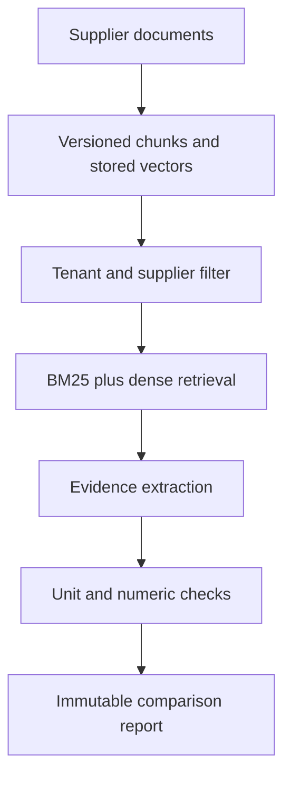

# Vendor Evidence RAG
[](https://github.com/AmmarFarid10/vendor-evidence-rag/actions/workflows/ci.yml)

**Compare supplier quotations against purchasing requirements and show the evidence behind every result.** Procurement teams lose time reconciling lead times, prices and warranty terms across competing documents. This API versions the source documents, retrieves supplier-specific evidence and produces an auditable comparison with `met`, `not_met` or `unknown` results.

## Concrete demonstration
Three fictional industrial-switch quotations are compared against delivery ≤14 days, warranty ≥24 months and unit price ≤USD 130. Acme meets the sample requirements; Beacon misses delivery/warranty; Cedar has no supported price and stays unknown. These are synthetic test facts, not real suppliers or business results.

## What is implemented
- Tenant- and role-filtered knowledge ingestion; source revisions and embedded chunks persist in SQLite.
- Overlapping word chunks, pretrained dense embeddings, BM25 and reciprocal rank fusion. Retrieval filters tenant, entity and scope **before** candidate ranking.
- Explicit numeric units and deterministic requirement comparisons. Conflicting values stay unknown; there is no guessed currency conversion.
- Optional local-model evidence selection with schema, quote and citation validation; the model cannot invent an observed numeric value.
- Immutable, idempotent comparison reports with a complete active-document snapshot. Concurrent source changes reject report creation.
- Cited extractive Q&A scoped to one supplier; optional quote-validated local-model selection.

The numeric comparison parser intentionally recognizes labeled terms such as `Delivery days: 10`, `Warranty months: 24`, `Unit price USD: 120` and `Capacity units: 500`. Free-form contracts, exclusions, taxes, delivery calendars and legal interpretation are not automatically resolved. Q&A exposes evidence for manual review; missing or incompatible units remain unknown. This boundary avoids presenting a general-purpose contract interpreter as completed work.

## Run it
Python 3.12 and uv are required. Start with the self-contained API demo; it creates temporary data and fresh test identities and makes no external model/service calls:

```bash
uv sync --frozen --extra dev
uv run python scripts/demo.py --check
```
Then run the same demo using the pretrained ONNX embedding model:

```bash
uv run python scripts/demo.py --semantic
RUN_SEMANTIC=1 uv run pytest -q -m semantic
uv run python scripts/evaluate.py --semantic
```
FastEmbed downloads the public `BAAI/bge-small-en-v1.5` quantized model on first use. It runs on CPU through ONNX Runtime; no model training or paid API is required. The model has an MIT license according to its upstream model metadata. `MODEL_CACHE` controls caching. The dependency lock pins Python packages, not an immutable future copy of model-hosted weights; see the recorded model manifest in `docs/` and re-embed documents when changing model/version. Hash mode is an explicitly labeled lexical baseline, not semantic AI.

For a persistent API:

```bash
eval "$(uv run python scripts/make_keys.py)"
EMBEDDER=fastembed uv run uvicorn app.api:app --host 127.0.0.1 --port 8000 --workers 1
```
The key generator prints one shell export containing an operator and a different reviewer. Keep that environment local and never commit its output. Copy the appropriate key from `AUTH_KEYS_JSON` into `Authorization: Bearer <key>` in `/docs`. Each identity's tenant, subject and role are server configured; request JSON cannot override them. `/health` and API schema are public; business endpoints require authentication.

`EMBEDDER=hash` runs a reproducible offline lexical-vector baseline. `EMBEDDER=fastembed` is the default. An index stores the selected encoder name and will not silently mix vectors from different encoders: re-ingest documents after changing it.

```bash
docker compose up --build
```
Compose binds only `127.0.0.1:8000`; change the host port to run multiple projects together. Storage and model caches use named volumes. The image runs as a non-root user. Docker on Linux uses a host-gateway mapping for an existing local Ollama server; Docker Desktop uses the same hostname.

Optional local LLM features use an existing Ollama `qwen3:4b`. Set `OLLAMA_MODEL` for another installed model and keep `OLLAMA_BASE_URL` on the supported local endpoint. No remote paid-provider fallback occurs. A missing model produces an explicit API error or failed workflow rather than a fabricated answer. Network/timeouts and 429/5xx responses have bounded retries; malformed JSON and invalid schemas fail closed. This repo includes transport-mocked model tests. Live Ollama generation is not claimed as tested in this review.


## API walkthrough
1. POST `/documents` using examples from `examples/vendors.json`. `entity` is the supplier ID. Keep unrelated suppliers separate.
2. POST `/comparisons` using the fixture's `comparison` object and an `Idempotency-Key` header.
3. GET `/comparisons/{id}` to retrieve the immutable report as its creator or same-tenant reviewer.
4. POST `/query` with `supplier`, `question`, optional retrieval `mode`, and optional `generate:true`.
5. Set `extractor:"ollama"` on a comparison for local-model evidence selection. Unsupported model claims make an observation unknown; they never make a failed requirement pass.

```json
{"suppliers":["acme"],"requirements":[{"attribute":"delivery_days","operator":"le","value":14}]}
```



## Quality and operating limits
```bash
uv run ruff check .
uv run mypy app --ignore-missing-imports
uv run pytest -q -m 'not semantic'
uv run pip-audit
```
GitHub Actions runs the checks, an end-to-end API demo, and a Docker build plus containerized demo. The manual **Pretrained retrieval check** workflow downloads and executes actual embeddings and reports a small retrieval ablation. The same evaluation can be reproduced locally. `docs/VERIFICATION.md` records executed results; `docs/EXPERIMENTS.md` explains trade-offs. Synthetic fixtures demonstrate mechanics, not production accuracy or customer outcomes.

This is an independently runnable reference implementation, not a claim of a production deployment. SQLite and a process lock support **one worker**. Multi-worker deployment needs database-backed run locking, a shared checkpoint backend, tenant quotas and retention/backup operations. Configure TLS and real identity management before exposure. API keys are configured through the environment; there is no signup/password service. Request bodies, document size and CSV size (where used) are bounded. Input is treated as untrusted data; exact quote checks reduce unsupported claims but cannot certify source truth or defeat every prompt injection.

Application events store identifiers, hashes, statuses and counts, not credentials, uploaded content or model prompts. Request IDs and duration headers support tracing. Returned proposals and evidence intentionally include authorized source excerpts, so restrict downstream logging and retention. Schema version 1 is explicit; a future incompatible schema requires a migration rather than deleting existing data.

`app/core` is intentionally shared infrastructure across this portfolio's three projects. Each repository includes its own copy for standalone installation; domain services, datasets, workflow invariants and evaluations are project-specific. A larger organization could extract the common code into a separately versioned internal package.

